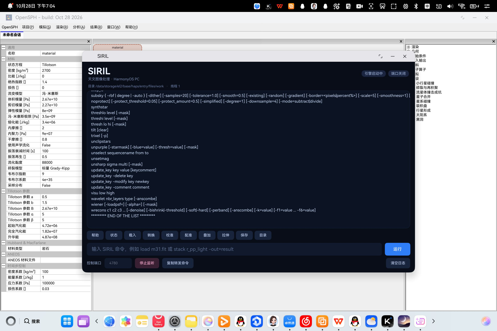

# SIRIL HarmonyOS — test report

**Date:** 2026-10-28
**Device:** HUAWEI MateBook `HAD-W32`, HarmonyOS 7.0.0, API 26, arm64-v8a
**App:** `com.joinother.siril`, signed with an AGC debug certificate/profile
**Engine:** SIRIL 1.5.0-dev (`e17d9ffcf`), headless + `libsiril-ohos.so`
**Host:** macOS 27.2 (arm64), DevEco Studio 26.0.0, hdc 3.2.0f


## Transport and catalog

```
$ node scripts/siril-cli.mjs --status
引擎版本   1.5.0
工作目录   /data/storage/el2/base/haps/entry/files/work
当前图像   -
当前序列   -
线程数     1

$ node scripts/siril-cli.mjs --list | tail -1
共 218 条命令

$ node scripts/siril-cli.mjs --describe stack
stack
  用法     stack seqfilename\n stack seqfilename { sum | min | max } ...
  最少参数 1
  可脚本化 是
  前置条件 无
```

## End-to-end pipeline (synthetic 512×512 star field, 5 frames)

```
$ node scripts/siril-cli.mjs --command "convert light"
Convert: processing 5 files...
Conversion succeeded, 5 file(s) created for 5 input file(s) (5 image(s) converted, 0 failed)
Writing sequence file light_.seq

$ node scripts/siril-cli.mjs --command "register light"
dx:          +6.80 px
dy:          -4.08 px
5 images processed.
Total: 0 failed, 5 registered.

$ node scripts/siril-cli.mjs --command "stack r_light_ rej 3 3 -out=stacked"
Rejection stacking complete. 5 images have been stacked.
Saving FITS: file stacked.fit, 1 layer(s), 512x512 pixels, 32 bits
Background noise value (channel: #0): 2.709 (4.133e-05)

$ node scripts/siril-cli.mjs --command "load stacked"
Reading FITS: file stacked.fit, 1 layer(s), 512x512 pixels, 32 bits

$ node scripts/siril-cli.mjs --command "autostretch"
Unlinked MTF stretch (Ch 0: lo=0.012045, mid=0.002375, hi=1.000000)
Autostretch succeeded.

$ node scripts/siril-cli.mjs --command "stat"
B&W layer: Mean: 16675.1, Median: 16533.1, Sigma: 6171.8, Min: 2117.6, Max: 64481.1

$ node scripts/siril-cli.mjs --command "savepng stacked_preview"
Saving PNG: file stacked_preview.png, 1 layer(s), 512x512 pixels
```

The registration shifts (+6.80 / −4.08 px) match the synthetic dither that the
generator applies to the last frame, so star matching, transformation solving
and resampling all ran on-device.

The stacked FITS header written by the engine proves the stack metadata:

```
STACKCNT=                    5 / Stack frames
HISTORY mean stacking with winsorized sigma clipping rejection (low=3.000 high=3.000)
```

## In-app console (NAPI path)

The ArkTS console executes commands through the same NAPI module the port
uses.  Pressing the **帮助** quick action produced:

```
[19:04:35] > help
[19:04:35] Running command: help
********* LIST OF AVAILABLE COMMANDS *********
addmax filename [-mask]
...
```



## Automated suite

`scripts/test-ohos-cli.mjs` restarts the app (clean test directory), forwards
the port and runs 13 checks:

```
PASS  transport: ping
PASS  engine: status  — version 1.5.0
PASS  catalog: 200+ commands  — 218 commands
PASS  catalog: stack present
PASS  engine: help
PASS  engine: cd working directory
PASS  pipeline: convert
PASS  pipeline: register
PASS  pipeline: stack
PASS  pipeline: load
PASS  pipeline: stat
PASS  pipeline: savepng
PASS  error: unknown command rejected

13/13 checks passed
```

Exit code is `1` when a command fails:

```
$ node scripts/siril-cli.mjs --command "not_a_command" ; echo $?
Command execution failed: unknown command name
1
```

## Fixes found by the device tests

1. **`gfit` was never allocated.**  `main-cli.c` allocates it before running
   commands; the embedding bridge did not, so the first `load` dereferenced
   NULL.  The bridge now allocates it and calls
   `initialize_siril_directories()` before the engine starts.
2. **Line protocol broke on pretty-printed catalog JSON.**  The catalog is now
   minified when loaded so one response is exactly one line.
3. **GLib `GSocketService` never dispatched** because the service was created
   on the ArkTS thread but the main loop ran on another.  The control server is
   now a plain POSIX socket with its own accept thread, which is also easier to
   stop from the UI.
4. **ArkTS bootstrap failed on `mkdirSync` for existing directories.**  The
   application now tolerates `EEXIST` and copies rawfile assets safely.

## Limits measured during testing

* HarmonyOS destroys the ability (`window stage destroyed` / `ability
  destroyed`) when the application stays in the background; the test harness
  restarts it before each run.  Long interactive sessions need the window to
  stay in the foreground.
* Repeated `convert` into a directory that already contains previous outputs
  grows the input set every run; the UI cleans `work/testrun` on launch so the
  fixture stays at five frames.
* Online features (`spcc` mirror sync, plate solving downloads) require
  libcurl, which this headless build disables; the command reports the feature
  as unavailable instead of failing silently.
